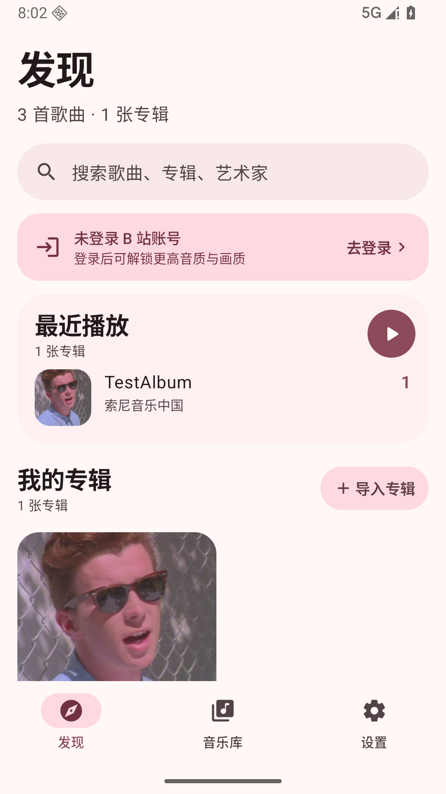
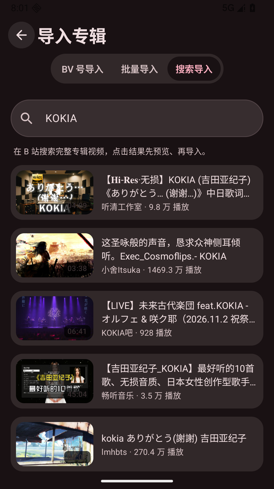
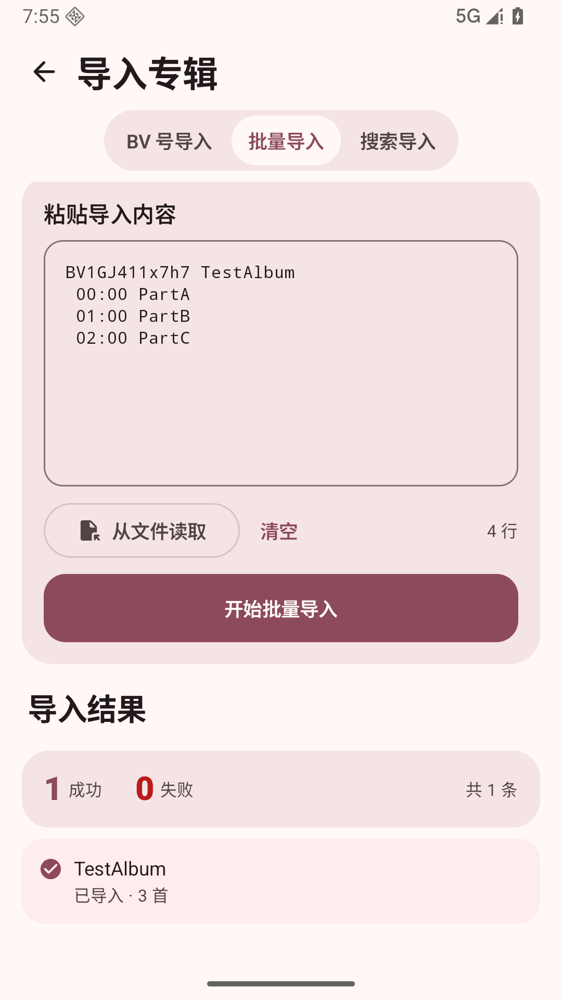

# 哔哩专辑 · BiliAudio

> 把 B 站上的「完整专辑视频」变成真正可搜索、可分曲、可后台播放的音乐播放器。

B 站有很多 UP 主发布整张专辑的完整视频（一个视频 = 一整张专辑），但用 B 站本身听歌很麻烦：收藏的视频不能当歌曲搜、分曲只能翻评论区分割点、想要「歌词」只能看视频。

**哔哩专辑** 把这些视频导入成「专辑 → 歌曲」：

- 🔐 **B 站扫码登录**（Cookie 持久化，登录后可解锁更高音质/画质）
- 📥 **导入专辑**：粘贴 BV 号 / 视频链接解析预览，一键导入
- 🧩 **分曲编辑**：输入时间点 + 歌名切分整张专辑；支持「用当前播放位置」打点；支持文件/文本批量导入
- 🎵 **按歌曲播放**：专辑音频流连续播放，播放列表 = 当前专辑的分割点，点哪首播哪首；后台播放 + 媒体通知 + 锁屏控制
- 🎬 **歌词页 = 原视频**：播放 B 站原视频，与音频进度同步，支持全屏 / 非全屏两种模式
- 🔎 **可搜索的音乐库**：歌曲 / 专辑搜索，按艺术家、专辑名检索
- 🎨 **Material 3 扁平设计**：封面大图、大圆角卡片、动态色板，无液态玻璃

## 界面截图

| 发现 | 正在播放 | 歌词视频（原视频） |
| --- | --- | --- |
|  |  |  |

| 分曲编辑 | 搜索导入 | 深色主题 |
| --- | --- | --- |
|  |  |  |

| 专辑详情（底部迷你播放条） | 歌词页全屏 | 批量导入 |
| --- | --- | --- |
|  |  |  |

更多截图见 [`docs/screenshots/`](docs/screenshots/)。

## 技术栈

- Kotlin + Jetpack Compose（Material 3，material-kolor 动态色板）
- Media3 ExoPlayer + MediaSessionService（后台播放 / 媒体通知 / 第二路视频播放器）
- OkHttp + kotlinx.serialization（B 站 API / wbi 签名 / 扫码登录）
- Room（专辑与分曲持久化）、Coil（封面加载）、Navigation Compose
- 最低 Android 7.0（API 24），targetSdk 37

## 构建

```bash
# 需要 JDK 17+（Android Studio 自带 JBR 即可）
export JAVA_HOME=/opt/android-studio/jbr
./gradlew :app:assembleDebug
# 产物：app/build/outputs/apk/debug/app-debug.apk
```

> Gradle 发行版走腾讯镜像（`gradle/wrapper/gradle-wrapper.properties`），国内网络可直接构建。
> 如果 Android Studio 新建项目后 wrapper 指向 `services.gradle.org`，把它改成
> `https://mirrors.cloud.tencent.com/gradle/gradle-<版本>-bin.zip` 即可。

运行单元测试：

```bash
./gradlew :app:testDebugUnitTest
```

模拟器冒烟测试（可选，用于截图走查）：

```bash
scripts/emulator.sh start   # 启动 headless 模拟器（需预装 AVD）
scripts/screenshot.sh home 8
```

## 使用流程

1. **登录（可选）**：设置 → 去登录，用 B 站 App 扫码。未登录也可以导入和播放（音质/画质受限）。
2. **导入专辑**：发现页 → 导入专辑：
   - **BV 号导入**：粘贴 `BV...` 或视频链接 → 解析预览（封面/标题/UP 主/时长/分 P）→ 可改专辑名/艺术家 → 导入；
   - **批量导入**：粘贴 JSON / CSV / 文本块（格式见下方）→ 开始批量导入；
   - **搜索导入**：关键词搜索 B 站视频 → 预览 → 导入。
3. **分曲**：进入专辑 → 编辑分割点：
   - 手动输入时间点（`mm:ss` / `mm:ss.SSS` / `hh:mm:ss` / 秒数）+ 歌名 → 添加；
   - 或先试听专辑，点「用当前位置」自动取当前播放时间（吸附到 0.5s）；
   - 支持编辑/删除/按时间排序，保存后专辑即变成多首歌。
4. **播放**：专辑页「播放全部」，或音乐库点歌；底部迷你播放条 → 正在播放页（播放列表面板 = 当前专辑分曲）。
5. **歌词页**：正在播放页 →「看歌词视频」，观看 B 站原视频（与音频同步），右上角可切换全屏。

### 批量导入格式

自动识别 JSON 数组 / CSV / 文本块，详见 [docs/IMPORT_FORMATS.md](docs/IMPORT_FORMATS.md)。

```text
BV1GJ411x7h7 专辑名
  00:00 曲目一
  03:21 曲目二
  07:45.500 曲目三
```

```csv
BV1GJ411x7h7,专辑名,艺术家,00:00,曲目一
BV1GJ411x7h7,专辑名,艺术家,03:21,曲目二
```

```json
[{"bvid":"BV1GJ411x7h7","title":"专辑名","artist":"艺术家",
  "segments":[{"start":"00:00","name":"曲目一"},{"start":"03:21","name":"曲目二"}]}]
```

> 同一 BV 号重复导入会覆盖更新（保留专辑 id 与播放次数）。

## 已知限制 / 路线图

- **多 P 视频自动分曲**尚未支持（当前按单视频导入后手动分曲）；
- 歌词页视频清晰度登录后可提升（未登录实测最高 480P）；全屏为竖屏铺满，横屏全屏待做；
- 播放地址会过期，出错时自动重新解析一次；暂不做离线缓存；
- 搜索接口偶发被 B 站风控（会提示可重试）；
- 后续：B 站收藏夹批量导入、离线下载、自动静音切分、均衡器、封面取色主题、歌单。

## 项目结构

```
app/src/main/java/com/wonderlandkid/biliaudio
├── data/       # B站 API(wbi签名/扫码登录)、Room、仓库、媒体流解析
├── player/     # 播放引擎(ExoPlayer 分曲裁剪)、后台服务、歌词页视频
├── ui/         # Compose 界面：发现/音乐库/专辑/分曲编辑/导入/登录/设置/播放器/歌词页
├── di/         # 手写 DI 容器
└── util/
docs/           # 设计文档、B站接口笔记、导入格式、截图
```

## 说明

本项目为个人学习自用工具，仅用于播放用户自己可访问的 B 站内容；B 站内容版权归原作者及平台所有，请勿用于商业用途或大规模抓取。
